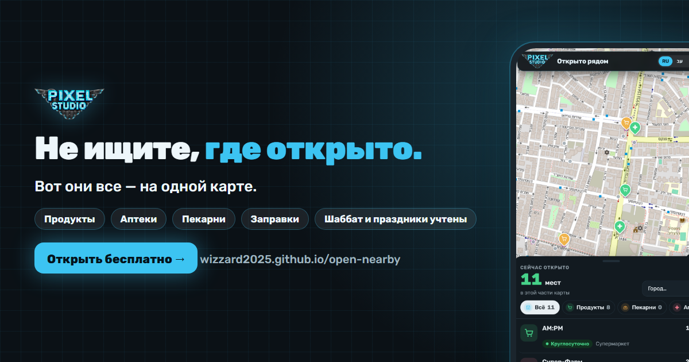

<p align="center">
  
</p>

<p align="center">
  <b><a href="https://betahopen.app/">betahopen.app</a></b><br>
  <a href="#עברית">עברית</a> · <a href="#русский">Русский</a> · <a href="#english">English</a>
</p>

<p align="center"></p>

---

<div dir="rtl" lang="he">

## עברית

### בטח פתוח

**לא צריך לחפש מה פתוח. הנה כולם, על מפה אחת.**

פותחים את האפליקציה ורואים מיד אילו חנויות פתוחות עכשיו לידכם, ועד מתי. בכל הארץ, בעברית, ברוסית ובאנגלית. בחינם, בלי הרשמה ובלי התקנה.

**מה כבר עובד (גרסת בטא)**

- המיקום שלכם, בחירת עיר או נקודה על המפה. אפשר לשתף קישור למקום.
- סופרמרקטים, מאפיות, בתי מרקחת ותחנות דלק, עם סטטוס חי: „פתוח עד 23:00", „נסגר בעוד 9 דק׳", „סגור, נפתח מחר ב־07:00".
- שעות של רשתות גדולות (שופרסל, סופר־פארם, רמי לוי, ויקטורי, אושר עד) מתעדכנות כל יום.
- שבת וחגים: זמני הדלקת נרות ויציאת שבת, אזהרה בחג.
- מסלול הליכה ודקות הליכה, ניווט ב־Google Maps או Waze, חיוג.
- טלפון ומחשב, מצב כהה, אפשר להתקין כאפליקציה (PWA). אפליקציה ל־Android בדרך.

**מיתוג:** לוגו, אייקונים ומודעות מוכנות בשלוש שפות נמצאים בתיקייה [`brand/`](brand/), וספר המותג באתר: [`/brand/`](https://betahopen.app/brand/).

**הרצה מקומית:** `python -m http.server 8765` ואז http://localhost:8765

</div>

---

## Русский

### Точно открыто (בטח פתוח)

**Не ищите, где открыто. Вот они все, на одной карте.**

Открываешь приложение и сразу видишь, какие магазины рядом открыты прямо сейчас и до скольки. Израиль, на иврите, русском и английском. Бесплатно, без регистрации и установки.

**Бренд:** логотип, иконки, палитра и готовые рекламные макеты на трёх языках лежат в [`brand/`](brand/), брендбук на сайте: [`/brand/`](https://betahopen.app/brand/). Макеты пересобираются скриптом `brand/_src/render_ads.py`.

#### Что уже работает (MVP)

- Геолокация, выбор города или точка на карте. Ссылкой можно поделиться (`#широта,долгота`).
- Продукты, пекарни, аптеки, заправки. Статусы: «Открыто до 23:00», «Закроется через 9 мин», «Закрыто, откроется завтра в 07:00», «Часы не указаны».
- Расписание на неделю, маршрут через Google Maps или Waze, звонок.
- Шаббат и праздники через Hebcal: время зажигания свечей и исхода шаббата, предупреждение в праздник.
- Понимает израильские форматы часов: `24/6`, `Fr 07:00-(sunset-02:00)`, правила `PH`.
- Если рядом мало открытых магазинов, поиск сам расширяется до 3 км.
- Вёрстка под телефон и компьютер, иврит справа налево, тёмная тема, можно установить как приложение (PWA).

#### Как запустить локально

```bash
python -m http.server 8765
```
Затем откройте http://localhost:8765.

Ежедневное обновление часов сетей идёт с компьютера в Израиле: задача Windows «OpenNearby daily refresh» запускает `tools/daily_refresh.ps1`, лог пишется в `%LOCALAPPDATA%\open-nearby\refresh.log`. Серверы GitHub сайты сетей блокируют, поэтому ночной запуск на GitHub обновляет только OpenStreetMap и берёт часы сетей из последней копии в `data/chains/`.

Обновить данные вручную: `python tools/update_data.py`. Скачивается вся страна, около 5000 точек, примерно 1 минута.

#### Данные: честная картина

| Источник | Покрытие | Цена |
|---|---|---|
| OpenStreetMap | ~5000 точек, часы есть у 15% | бесплатно |
| **+ сети (сейчас):** Шуферсаль (431), Супер-Фарм (305), Рами Леви (43) | 5427 точек, **часы есть у 26%** | бесплатно, `tools/chains.py` |
| Делек (готово, выключено: `--with-delek`) | заправки и магазины «Мента» | нужно согласие Делека |
| Google Places API | почти все магазины, с часами | платно сверх бесплатной квоты, нужен свой сервер |
| Сайты сетей (Шуферсаль, Рами Леви, AM:PM, Супер-Фарм…) | часы всех филиалов сети | бесплатно, нужен парсер под каждую сеть |
| Пользователи («здесь открыто / закрыто») | растёт с аудиторией | бесплатно, нужна модерация |

#### План запуска

1. **Хостинг.** GitHub Pages или Cloudflare Pages, бесплатно. `.github/workflows/deploy.yml` уже обновляет данные каждую ночь и публикует сайт.
2. **Карта.** Тайлы tile.openstreetmap.org нельзя использовать в продакшене. Нужен MapTiler, Stadia или Carto: бесплатный тариф, ключ.
3. **Покрытие часов.** Это главное: сначала парсеры часов 10–15 крупных сетей, потом кнопка «сообщить часы», потом, если понадобится, Google Places.
4. **Израильские фичи.** Фильтр «открыто в шаббат», кашрут, «открыто ночью».
5. **Сторы.** Сначала PWA, затем обёртка Capacitor для Google Play и App Store.

---

## English

### Betcha it's open (בטח פתוח)

**Stop searching for what's open. Here they all are, on one map.**

Open the app and instantly see which shops near you are open right now, and until when. All of Israel, in Hebrew, Russian and English. Free, no sign-up, nothing to install.

**Working now (beta)**

- Your location, a city, or any point on the map; shareable links.
- Groceries, bakeries, pharmacies and gas stations with live status: "Open until 23:00", "Closes in 9 min", "Closed, opens tomorrow at 07:00".
- Hours for major chains (Shufersal, Super-Pharm, Rami Levy, Victory, Osher Ad) refreshed daily.
- Shabbat and holidays: candle lighting and Havdalah times, holiday warnings.
- Walking routes and times, directions via Google Maps or Waze, tap to call.
- Phone and desktop, dark mode, installable as an app (PWA). Android app coming.

**Brand kit:** logo, icons and ready-made ads in three languages are in [`brand/`](brand/); the brand book is at [`/brand/`](https://betahopen.app/brand/).

**Run locally:** `python -m http.server 8765`, then open http://localhost:8765

Map data © [OpenStreetMap](https://www.openstreetmap.org/copyright) contributors.
